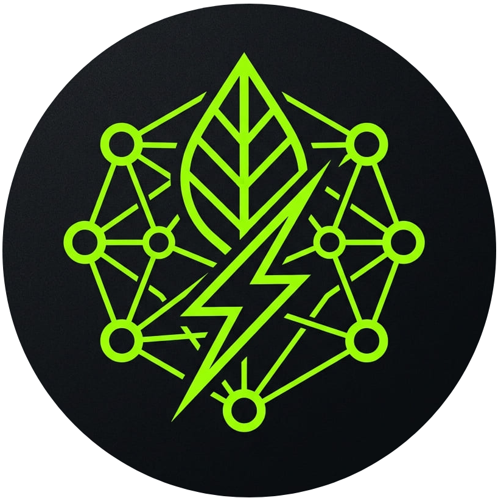
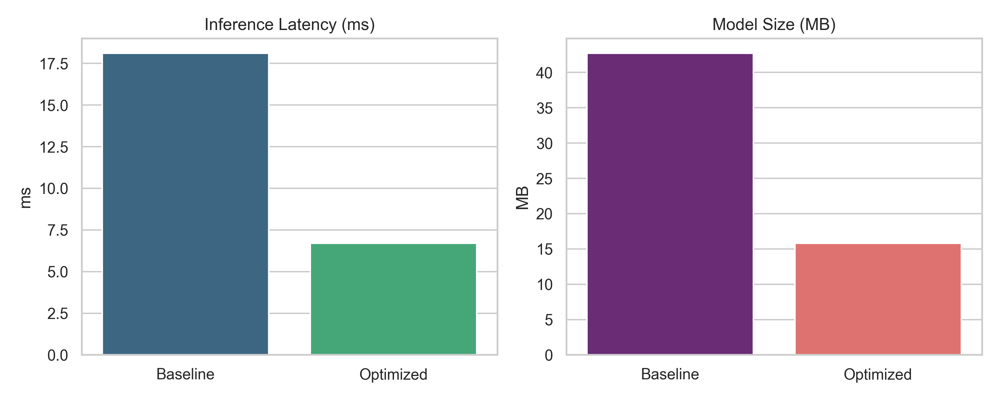

<p align="center">
  
</p>

# EcoEdge-AI 🌿

<p align="center">
  <a href="https://pypi.org/project/ecoedge-ai/"></a>
  <a href="https://opensource.org/licenses/MIT"></a>
  <a href="https://ko-fi.com/ecoedgeai"></a>
  
</p>

EcoEdge-AI is a lightweight Python framework designed to compress, quantize, and optimize deep learning models for edge devices with minimal accuracy loss.

---

## 🚀 New Advanced Features (Advanced Edge Modules)

### 1. ONNX Graph Surgeon (`ecoedge/export/graph_surgeon.py`)
* **Problem Solved:** Prevents **Ghost Gradient Mismatch** and **silent tensor drift** on Edge devices caused by orphaned initializers and distorted shape attributes after structured pruning and dynamic axis ONNX export.
* **Usage:**
```python
from ecoedge.export.graph_surgeon import sanitize_pruned_onnx_model

sanitize_pruned_onnx_model("model.onnx", "ecoedge_optimized.onnx")

```

### 2. Adaptive Piecewise Quantizer (`ecoedge/compression/adaptive_quantizer.py`)

* **Problem Solved:** Eliminates **Zero-Point Drift** and NPU register saturation when quantizing sparse, bimodal weight distributions resulting from fine-grained pruning.
* **Usage:**

```python
from ecoedge.compression.adaptive_quantizer import AdaptivePiecewiseQuantizer

quantizer = AdaptivePiecewiseQuantizer(model, bits=8)
quantizer.apply_soft_threshold_quantization()

```

---

## 📦 Installation

Install EcoEdge-AI directly from PyPI or your local repository:

```bash
pip install ecoedge-ai

```

## 📊 Benchmarks



---

## 📝 License

Distributed under the MIT License. See `LICENSE` for more information.
